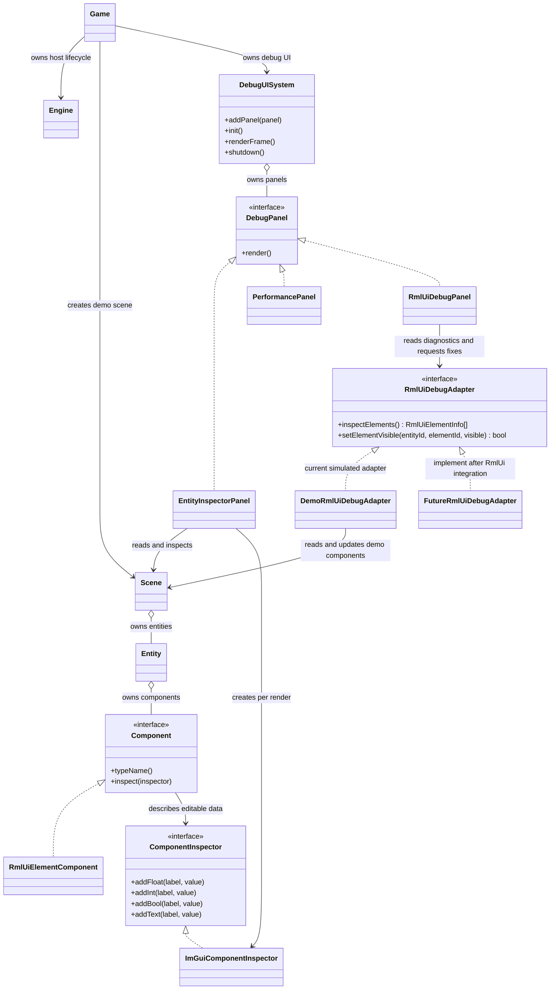

# Dear ImGui Debug UI PoC

## Purpose and current boundary

This PoC proves how an immediate-mode debug UI can be hosted by the existing engine target, inspect ECS-style data, identify a simple UI-state inconsistency, and request a correction through an adapter.

**RmlUi is not installed or connected in this repository.** The running PoC uses `DemoRmlUiDebugAdapter` and `RmlUiElementComponent` to simulate a document, element, visibility and active state. The "Apply correction" button changes that demo component only. It does not inspect or fix a live RmlUi document.

## High-level class diagram

## Design choices

- **Facade — `DebugUISystem`:** owns GLFW, the ImGui context, input/render backends, frame order and shutdown. The game loop does not call these libraries directly.
- **Panel interface — `DebugPanel`:** lets engine debug windows be registered without adding panel-specific branches to the frame loop.
- **Adapter — `RmlUiDebugAdapter`:** isolates the debug panel from the eventual RmlUi API. The current demo adapter talks to the PoC scene; a future adapter should map real RmlUi elements to `RmlUiElementInfo` and perform mutations on the correct RmlUi/UI thread.
- **ECS-friendly component inspection:** components expose their own debug fields through `ComponentInspector`; UI drawing is kept out of component implementations. The included `Scene`/`Entity` classes are a PoC stand-in, not a replacement for the project's eventual ECS.

## Current diagnostic

The demo creates a `Menu` entity with a `main-menu` UI-element component that is **active but hidden**. `RmlUiDebugPanel` detects this invariant violation and offers an explicit "Apply correction: show element" action. The adapter reports failure if the target no longer exists; the panel surfaces that failure instead of pretending the update succeeded.

This one rule demonstrates the diagnostic/correction workflow only. It does not establish that all active hidden elements are bugs in the real RmlUi prototype; the game/UI team must confirm the intended semantics before adopting it.

## Connecting a real RmlUi prototype later

1. Keep the UI panel dependent on `RmlUiDebugAdapter`, not on RmlUi headers.
2. Implement the adapter in the module that owns the RmlUi context and document lifecycle.
3. In `inspectElements()`, safely enumerate valid live elements and return stable identifiers plus the state needed by diagnostics. Do not keep raw element pointers in the panel across frames.
4. In `setElementVisible()`, resolve the identifier against the current live context, check that the element is still valid, apply visibility using the project's RmlUi version, and return `false` if lookup or mutation cannot be completed.
5. Register the real adapter in `game/src/main.cpp` in place of `DemoRmlUiDebugAdapter`; keep its referenced scene/context alive longer than `RmlUiDebugPanel`.
6. Add tests for the real adapter's lookup, stale-target handling, diagnostic semantics and correction behavior. Add RmlUi to vcpkg only when the actual project integration and desired version are agreed.

## Dear ImGui/GLFW usage notes

The library calls are wrapped in `DebugUISystem` and the panel/inspector implementations. Inline comments there explain the lifecycle and important API constraints, including `Begin`/`End` pairing, frame order, ID scoping, format strings, backend initialization and teardown order.

## Requirement coverage

| Requirement | PoC status |
|---|---|
| Uses Dear ImGui | Implemented with GLFW and OpenGL 3 backends. |
| Builds on the RmlUi prototype | Adapter seam is ready, but no RmlUi source/API is present to connect. |
| Demonstrates debugging and correction | Demonstrated against simulated state; real RmlUi diagnosis/correction remains to be integrated and validated. |
| Explains library usage in code | ImGui and GLFW lifecycle/control calls have explanatory comments in their wrappers. |
| Includes a high-level class diagram and pattern suggestion | This document; Facade, Panel interface and Adapter are described above. |
| Accounts for ECS | Uses a generic component inspection interface and a minimal PoC scene/entity/component model. |
