# Dear ImGui PoC — Class Diagram

The diagram below reflects the **current implementation**. `GameEntryPoint` represents the setup in `game/src/main.cpp`; it is not a separately declared C++ class.

The editable PlantUML source is [IMGUI_POC_CLASS_DIAGRAM.puml](IMGUI_POC_CLASS_DIAGRAM.puml). To view or export it visually in VS Code, install a PlantUML extension, open the `.puml` file, then run **PlantUML: Preview Current Diagram** or **PlantUML: Export Current Diagram** from the Command Palette. SVG export is scalable and suitable for slides or SharePoint.

```mermaid
classDiagram
    direction LR

    class GameEntryPoint {
        <<main in game/src/main.cpp>>
        +main()
    }
    class Engine {
        +init()
        +isRunning()
        +shutdown()
    }
    class DebugUISystem {
        <<Facade>>
        +addPanel(panel)
        +init()
        +renderFrame()
        +shouldClose()
        +shutdown()
    }
    class DebugPanel {
        <<interface>>
        +render()
    }
    class EntityInspectorPanel {
        +render()
    }
    class PerformancePanel {
        +render()
    }
    class RmlUiDebugPanel {
        +render()
    }

    class Scene {
        +createEntity(name) Entity
        +entities()
    }
    class Entity {
        +name()
        +id()
        +addComponent(type)
        +components()
    }
    class Component {
        <<interface>>
        +typeName()
        +inspect(inspector)
    }
    class TransformComponent {
        <<demo component in main.cpp>>
        +typeName()
        +inspect(inspector)
    }
    class RmlUiElementComponent {
        <<simulated RmlUi state>>
        +document()
        +elementId()
        +visible()
        +setVisible(visible)
        +active()
        +inspect(inspector)
    }
    class ComponentInspector {
        <<interface>>
        +addFloat(label, value)
        +addInt(label, value)
        +addBool(label, value)
        +addText(label, value)
    }
    class ImGuiComponentInspector {
        <<ImGui implementation>>
        +addFloat(label, value)
        +addInt(label, value)
        +addBool(label, value)
        +addText(label, value)
    }

    class RmlUiDebugAdapter {
        <<interface>>
        +inspectElements() RmlUiElementInfo[]
        +setElementVisible(entityId, elementId, visible) bool
    }
    class DemoRmlUiDebugAdapter {
        <<demo adapter>>
        +inspectElements() RmlUiElementInfo[]
        +setElementVisible(entityId, elementId, visible) bool
    }
    class RmlUiElementInfo {
        <<diagnostic snapshot>>
        +entityId
        +entityName
        +document
        +elementId
        +visible
        +active
        +hasActiveHiddenIssue()
    }

    class DearImGui {
        <<external library>>
    }
    class ImGuiGlfwBackend {
        <<Dear ImGui backend>>
    }
    class ImGuiOpenGL3Backend {
        <<Dear ImGui backend>>
    }
    class GLFW {
        <<external library>>
    }
    class OpenGL {
        <<graphics API>>
    }

    DebugPanel <|.. EntityInspectorPanel
    DebugPanel <|.. PerformancePanel
    DebugPanel <|.. RmlUiDebugPanel
    Component <|.. TransformComponent
    Component <|.. RmlUiElementComponent
    ComponentInspector <|.. ImGuiComponentInspector
    RmlUiDebugAdapter <|.. DemoRmlUiDebugAdapter

    Scene "1" *-- "0..*" Entity : owns
    Entity "1" *-- "0..*" Component : owns
    DebugUISystem "1" o-- "0..*" DebugPanel : owns registered panels

    GameEntryPoint ..> Engine : starts and stops
    GameEntryPoint ..> Scene : creates demo entities
    GameEntryPoint ..> DebugUISystem : initializes and runs frames
    GameEntryPoint ..> DemoRmlUiDebugAdapter : creates
    EntityInspectorPanel --> Scene : reads
    EntityInspectorPanel ..> ImGuiComponentInspector : creates while rendering
    Component ..> ComponentInspector : exposes editable fields through
    RmlUiDebugPanel --> RmlUiDebugAdapter : reads state and requests correction
    DemoRmlUiDebugAdapter --> Scene : reads and updates demo components
    DemoRmlUiDebugAdapter ..> RmlUiElementInfo : returns snapshots
    DemoRmlUiDebugAdapter ..> RmlUiElementComponent : looks up demo state

    DebugUISystem ..> DearImGui : creates context and renders frames
    DebugUISystem ..> ImGuiGlfwBackend : input and window integration
    DebugUISystem ..> ImGuiOpenGL3Backend : submits ImGui draw data
    ImGuiGlfwBackend ..> GLFW : platform backend
    ImGuiOpenGL3Backend ..> OpenGL : renderer backend
    ImGuiComponentInspector ..> DearImGui : widgets
    EntityInspectorPanel ..> DearImGui : tree and window widgets
    PerformancePanel ..> DearImGui : frame metrics and window widgets
    RmlUiDebugPanel ..> DearImGui : diagnostics and correction button
```

## Reading the diagram

- **Solid inheritance arrows** indicate implementations of interfaces.
- **Composition diamonds** indicate owned objects: a `Scene` owns its entities, an `Entity` owns its components, and `DebugUISystem` owns its registered panels.
- **Dashed arrows** indicate a dependency or a call/use relationship. Panels and adapters hold non-owning references to the scene/adapter they use. In `main.cpp`, those referenced objects are created before `DebugUISystem` and therefore outlive the registered panels.
- **Facade:** `DebugUISystem` hides the Dear ImGui, GLFW, OpenGL-backend initialization, frame sequence and shutdown from the game loop.
- **Adapter:** `RmlUiDebugPanel` depends on `RmlUiDebugAdapter`, not on RmlUi. `DemoRmlUiDebugAdapter` currently provides simulated ECS state. There is no real RmlUi adapter in this repository.
- **ECS consideration:** the diagram includes the PoC's minimal `Scene`/`Entity`/`Component` model. These classes demonstrate an inspection approach; they are not a claim that the engine already has a production ECS.

To add a real RmlUi connection later, implement `RmlUiDebugAdapter` beside the code that owns the RmlUi context and register that implementation instead of `DemoRmlUiDebugAdapter`.
